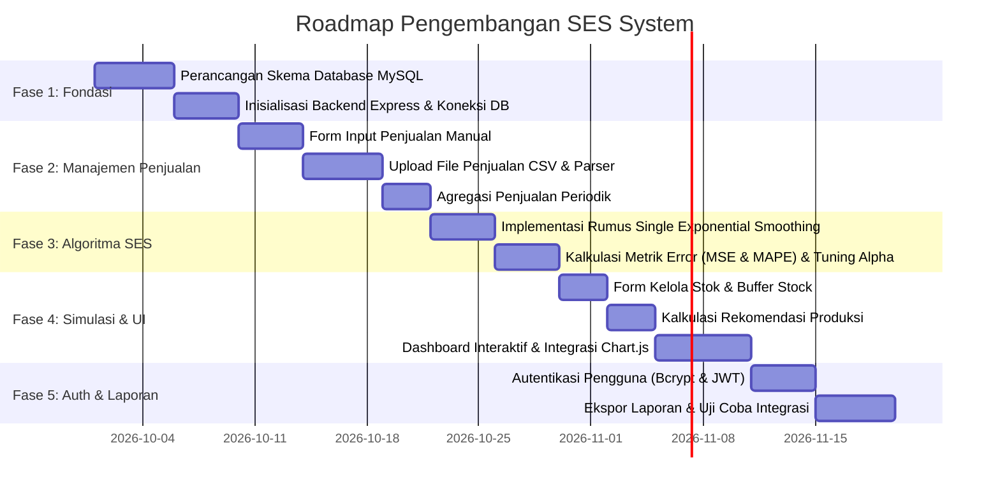
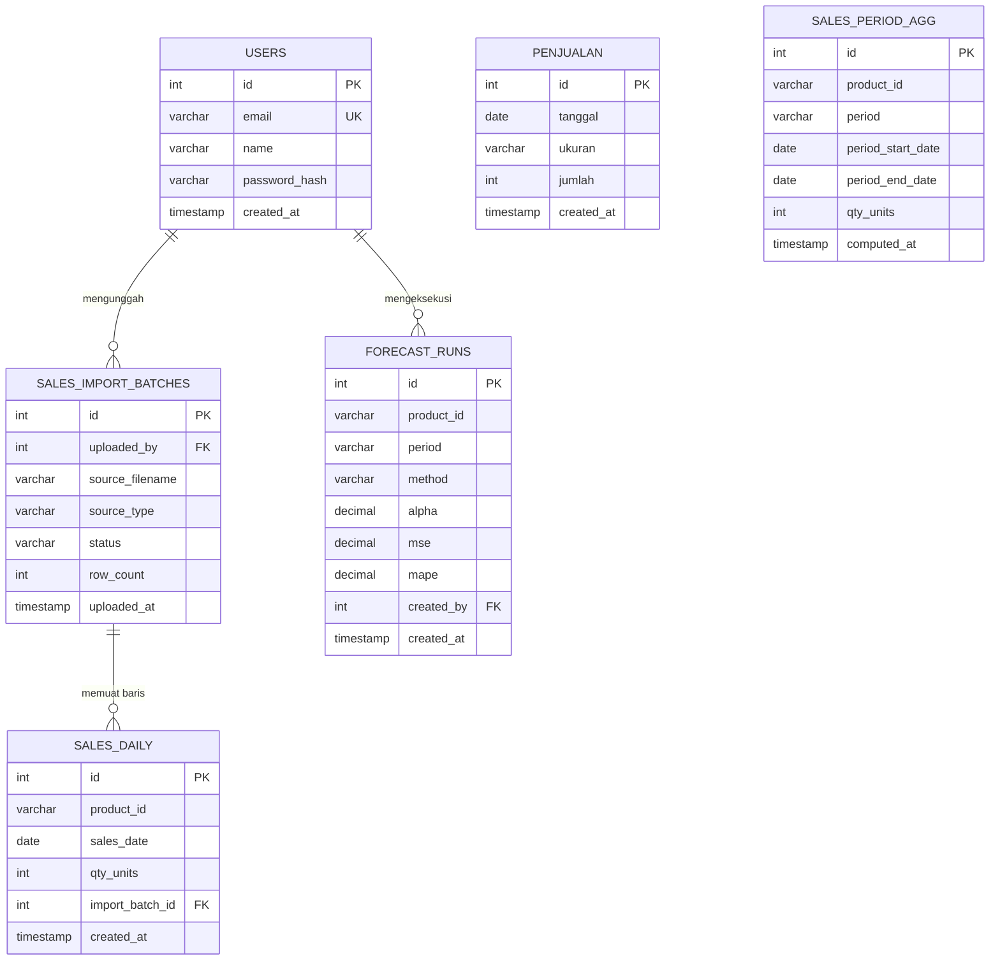
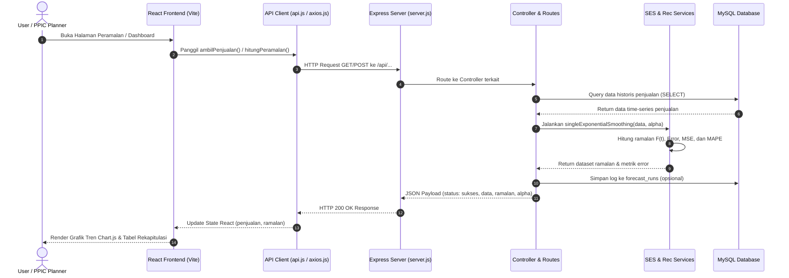

# Product Requirement Document (PRD)
## SES System — Sistem Peramalan Penjualan & Perencanaan Produksi

| Metadata | Keterangan |
| :--- | :--- |
| **Nama Produk** | SES System (Single Exponential Smoothing System) |
| **Versi Dokumen** | 1.0.0 |
| **Status Proyek** | In-Development / Active |
| **Pemilik Produk** | Tim Pengembang SES System |
| **Tech Stack** | React (Vite), Tailwind CSS, Chart.js, Node.js (Express), MySQL |

---

## 1. Pendahuluan & Latar Belakang

### 1.1 Apa itu PRD?
**PRD (*Product Requirement Document*)** adalah dokumen panduan teknis dan fungsional yang mendefinisikan secara komprehensif tujuan produk, fitur-fitur yang harus dikembangkan (*Functional Requirements*), standar kualitas (*Non-Functional Requirements*), perancangan basis data, arsitektur sistem, dan roadmap rilis. Dokumen ini menjadi acuan tunggal bagi *Product Manager*, *Software Engineer*, dan *Stakeholder*.

### 1.2 Latar Belakang Masalah (Problem Statement)
Pada industri manufaktur dan distribusi air minum dalam kemasan (varian 220ml, 330ml, 600ml), perencanaan produksi yang akurat sangat krusial:
1. **Risiko Overstock:** Produksi berlebih menyebabkan penumpukan barang jadi di gudang, meningkatkan biaya simpan (*holding cost*), dan risiko kerusakan kemasan/produk kadaluwarsa.
2. **Risiko Stockout:** Kekurangan produksi mengakibatkan hilangnya potensi pendapatan (*lost sales*) dan ketidakmampuan memenuhi permintaan pasar.
3. **Ketiadaan Sistem Peramalan Kuantitatif:** Keputusan produksi kerap diambil berdasarkan intuisi atau perkiraan kasar tanpa memanfaatkan data historis penjualan secara matematis.

### 1.3 Solusi Produk
Aplikasi **SES System** hadir sebagai solusi berbasis web yang:
- Mengelola data transaksi historis penjualan (input manual maupun bulk import berkas CSV).
- Mengimplementasikan metode peramalan kuantitatif **Single Exponential Smoothing (SES)**.
- Mengotomasi pencarian parameter pemulusan ($\alpha$ / alpha) terbaik berdasarkan metrik kesalahan terendah (**MSE** dan **MAPE**).
- Menghitung simulasi rekomendasi volume produksi dengan mempertimbangkan stok fisik saat ini dan stok pengaman (*buffer stock*).

---

## 2. Sasaran & Tujuan Produk (Objectives & Goals)

1. **Efisiensi Perencanaan:** Mengurangi waktu yang dibutuhkan tim PPIC (*Production Planning and Inventory Control*) dalam membuat jadwal produksi mingguan hingga 80%.
2. **Peningkatan Akurasi:** Meminimalkan deviasi antara peramalan dan realisasi penjualan dengan nilai MAPE ditargetkan $< 20\%$.
3. **Visibilitas Data:** Menyediakan antarmuka dashboard interaktif dengan grafik perbandingan tren penjualan aktual vs ramalan secara real-time.

---

## 3. Profil Pengguna (User Personas)

| Peran | Tanggung Jawab Utama | Kebutuhan Fitur |
| :--- | :--- | :--- |
| **Admin Penjualan (*Sales Admin*)** | Mengelola transaksi dan mengunggah data penjualan berkala. | Form input transaksi, modul upload CSV, tabel data historis. |
| **Perencana Produksi (*PPIC / Planner*)** | Menganalisis kebutuhan produksi dan menentukan parameter SES. | Pengaturan nilai $\alpha$, simulasi buffer stock, rekomendasi produksi. |
| **Manajer Operasional / Pimpinan** | Memantau kinerja peramalan dan mengevaluasi laporan. | Ringkasan KPI di Dashboard, grafik tren Chart.js, ekspor laporan. |

---

## 4. Perencanaan Produk & Roadmap (Product Planning)



---

## 5. Kebutuhan Fungsional (Functional Requirements / FR)

### FR-01: Manajemen Akses & Autentikasi Pengguna
- **FR-01.1:** Sistem mendukung pendaftaran pengguna baru (*Register*) dengan atribut: `name`, `email`, dan `password`.
- **FR-01.2:** Kata sandi disimpan menggunakan mekanisme *hashing* `bcryptjs`.
- **FR-01.3:** Sistem menyediakan fitur *Login* yang mengembalikan token stateless **JWT** (*JSON Web Token*) dengan masa berlaku 7 hari.

### FR-02: Manajemen & Input Data Penjualan
- **FR-02.1:** Pengguna dapat memasukkan data transaksi penjualan secara manual meliputi tanggal transaksi dan jumlah botol terjual per kemasan (220ml, 330ml, 600ml).
- **FR-02.2:** Formulir dilengkapi validasi agar tanggal dan angka penjualan tidak bernilai negatif atau kosong.

### FR-03: Upload Massal Transaksi Penjualan (CSV Import)
- **FR-03.1:** Sistem menyediakan modul unggah berkas CSV penjualan (`uploadSalesCSV.js`).
- **FR-03.2:** Sistem membaca baris CSV menggunakan `csv-parser` dan mencatat batch impor ke tabel `sales_import_batches`.
- **FR-03.3:** Baris transaksi otomatis disimpan ke tabel `sales_daily`.

### FR-04: Agregasi Data Penjualan
- **FR-04.1:** Sistem mampu melakukan agregasi berkala dari tabel transaksi harian ke dalam ringkasan bulanan/mingguan pada tabel `sales_period_agg`.

### FR-05: Mesin Peramalan (Forecasting Engine — SES)
- **FR-05.1:** Sistem menerapkan algoritma Single Exponential Smoothing dengan formula:
  $$F_t = \alpha \cdot Y_{t-1} + (1 - \alpha) \cdot F_{t-1}$$
  *di mana $F_t$ adalah nilai ramalan periode ke-$t$, $Y_{t-1}$ adalah data aktual periode sebelumnya, dan $\alpha$ adalah parameter pemulusan ($0 < \alpha < 1$).*
- **FR-05.2:** Data inisialisasi awal menggunakan nilai aktual pertama ($F_1 = Y_0$).

### FR-06: Evaluasi Akurasi & Pemilihan Parameter Alpha Terbaik
- **FR-06.1:** Sistem menghitung metrik kesalahan peramalan:
  - **Mean Squared Error (MSE):**
    $$MSE = \frac{1}{n} \sum_{t=1}^{n} (Y_t - F_t)^2$$
  - **Mean Absolute Percentage Error (MAPE):**
    $$MAPE = \frac{1}{n} \sum_{t=1}^{n} \left| \frac{Y_t - F_t}{Y_t} \right| \times 100\%$$
- **FR-06.2:** Sistem menguji rentang nilai $\alpha \in \{0.1, 0.2, 0.3, \dots, 0.9\}$ untuk memilih $\alpha$ dengan error terendah.

### FR-07: Kelola Stok Gudang & Buffer Stock
- **FR-07.1:** Pengguna dapat memasukkan parameter stok akhir di gudang (*Current Stock*) dan stok pengaman (*Buffer Stock*).
- **FR-07.2:** Panel kontrol parameter (*SESControlPanel*) dapat memicu kalkulasi ulang secara dinamis.

### FR-08: Simulasi & Rekomendasi Jumlah Produksi
- **FR-08.1:** Sistem menghitung rekomendasi kuantitas yang wajib diproduksi berdasarkan rumus:
  $$\text{Rekomendasi Produksi} = \max(0, F_{t+1} + \text{Buffer Stock} - \text{Stok Saat Ini})$$
- **FR-08.2:** Nilai rekomendasi produksi dibulatkan ke bilangan bulat (*integer*) dan tidak boleh bernilai negatif.

### FR-09: Dashboard & Visualisasi Interaktif
- **FR-09.1:** Menampilkan 4 kartu indikator statistik utama (*Stat Cards*): Total Penjualan, Total Ramalan, Jumlah Data Historis, dan Jumlah Periode.
- **FR-09.2:** Menampilkan grafik interaktif (Chart.js) dengan dua garis komparasi: Garis Aktual (biru) vs Garis Ramalan (ungu).
- **FR-09.3:** Menampilkan tabel riwayat penjualan dengan indikator tanggal/minggu, varian kemasan, dan jumlah unit.

### FR-10: Modul Laporan & Pencetakan
- **FR-10.1:** Menampilkan tabel rekapitulasi komprehensif yang memuat data historis, hasil ramalan, dan rekomendasi produksi.
- **FR-10.2:** Menyediakan aksi cetak/ekspor dokumen laporan perencanaan.

---

## 6. Kebutuhan Non-Fungsional (Non-Functional Requirements / NFR)

| Kategori | Parameter | Spesifikasi & Standar Kualitas |
| :--- | :--- | :--- |
| **Performa (*Performance*)** | Response Time API | Waktu respon endpoint kalkulasi peramalan $< 1.0$ detik untuk dataset $\le 10.000$ baris data. |
| **Performa Frontend** | Rendering Time | Waktu render grafik Chart.js dan tabel dashboard $< 500$ ms. |
| **Keamanan (*Security*)** | Enkripsi Password | Password di-hash menggunakan algoritma `bcryptjs` (salt rounds: 10). |
| **Keamanan Akses** | Autentikasi API | Endpoint terlindungi divalidasi menggunakan token JWT pada header `Authorization: Bearer <token>`. |
| **Keandalan (*Reliability*)** | Pool Koneksi DB | Menggunakan `mysql2/promise` dengan konfigurasi connection pool (10 koneksi simultan) untuk menjamin stabilitas. |
| **Ketahanan (*Robustness*)** | Error Boundary | Frontend dilengkapi komponen `ErrorBoundary.jsx` untuk menangkap crash komponen React tanpa mematikan aplikasi. |
| **Usabilitas (*Usability*)** | Responsivitas UI | Layout antarmuka adaptif untuk layar desktop dan tablet menggunakan utility-first styling Tailwind CSS. |
| **Maintainability** | Clean Architecture | Pemisahan tanggung jawab (*separation of concerns*) yang jelas antara router, controller, service layer, dan database config di backend. |

---

## 7. Desain Database (Database Schema & ERD)

### 7.1 Entity Relationship Diagram (ERD)



### 7.2 Kamus Data (Data Dictionary)

#### 1. Tabel `users`
| Kolom | Tipe Data | Keterangan |
| :--- | :--- | :--- |
| `id` | INT AUTO_INCREMENT (PK) | Pengenal unik pengguna |
| `email` | VARCHAR(191) UNIQUE | Alamat email aktif pengguna |
| `name` | VARCHAR(100) | Nama lengkap pengguna |
| `password_hash` | VARCHAR(255) | Hash kata sandi dari Bcrypt |
| `created_at` | TIMESTAMP | Waktu pembuatan akun |

#### 2. Tabel `penjualan`
| Kolom | Tipe Data | Keterangan |
| :--- | :--- | :--- |
| `id` | INT AUTO_INCREMENT (PK) | Pengenal unik data penjualan |
| `tanggal` | DATE | Tanggal penjualan |
| `ukuran` | VARCHAR(50) | Varian kemasan (contoh: 'Botol 500ml', '220ml') |
| `jumlah` | INT | Jumlah unit botol yang terjual |
| `created_at` | TIMESTAMP | Waktu pencatatan |

#### 3. Tabel `sales_daily`
| Kolom | Tipe Data | Keterangan |
| :--- | :--- | :--- |
| `id` | INT AUTO_INCREMENT (PK) | Pengenal baris penjualan harian |
| `product_id` | VARCHAR(50) | ID atau kode produk |
| `sales_date` | DATE | Tanggal transaksi harian |
| `qty_units` | INT | Jumlah unit terjual |
| `import_batch_id` | INT (FK) | Relasi ke batch impor CSV |
| `created_at` | TIMESTAMP | Waktu insert data |

#### 4. Tabel `sales_period_agg`
| Kolom | Tipe Data | Keterangan |
| :--- | :--- | :--- |
| `id` | INT AUTO_INCREMENT (PK) | Pengenal unik agregasi |
| `product_id` | VARCHAR(50) | ID produk |
| `period` | VARCHAR(20) | Tipe periode ('MONTH' / 'WEEK') |
| `period_start_date` | DATE | Tanggal awal periode |
| `period_end_date` | DATE | Tanggal akhir periode |
| `qty_units` | INT | Total unit akumulasi pada periode tersebut |
| `computed_at` | TIMESTAMP | Waktu agregasi dieksekusi |

#### 5. Tabel `forecast_runs`
| Kolom | Tipe Data | Keterangan |
| :--- | :--- | :--- |
| `id` | INT AUTO_INCREMENT (PK) | ID eksekusi peramalan |
| `product_id` | VARCHAR(50) | ID produk |
| `period` | VARCHAR(20) | Periode ramalan |
| `method` | VARCHAR(50) | Metode ('SES') |
| `alpha` | DECIMAL(4,2) | Nilai parameter $\alpha$ yang digunakan |
| `mse` | DECIMAL(12,4) | Nilai Mean Squared Error |
| `mape` | DECIMAL(8,4) | Persentase Mean Absolute Percentage Error |
| `created_by` | INT (FK) | ID user yang menjalankan |
| `created_at` | TIMESTAMP | Waktu eksekusi kalkulasi |

---

## 8. Arsitektur Sistem & Alur Aliran Data (Data Flow)



---

## 9. Struktur Folder Proyek

```text
SES2/
├── PRD.md                                # Dokumen Spesifikasi Produk (File Ini)
├── README.MD                             # Dokumentasi Umum & Arsitektur
├── backend/                              # Server Backend (Express.js)
│   ├── .env                              # Kredensial Environment & DB
│   ├── setup_database.sql                # Script Inisialisasi Database MySQL
│   ├── package.json                      # Dependensi Backend
│   └── src/
│       ├── server.js                     # Entry Point Server Express
│       ├── config/
│       │   └── db.js                     # MySQL Connection Pool
│       ├── controllers/
│       │   ├── authController.js         # Logika Autentikasi Pengguna
│       │   ├── ForecastController.js     # Controller Peramalan SES
│       │   ├── PenjualanController.js    # Controller Data Penjualan
│       │   └── uploadSalesCSV.js         # Controller Upload & Parser CSV
│       ├── middlewares/
│       │   └── auth.js                   # Middleware Verifikasi JWT
│       ├── routes/
│       │   ├── authRoutes.js             # Rute Autentikasi (/api/auth)
│       │   ├── forecastRoutes.js         # Rute Peramalan (/api/forecast)
│       │   └── penjualanRoutes.js        # Rute Penjualan (/api/sales & /api/penjualan)
│       ├── services/
│       │   ├── sesService.js             # Implementasi Formula Algoritma SES
│       │   └── recommendationService.js  # Formula Rekomendasi Produksi
│       └── utils/
│           └── aggregator.js             # Agregasi Data Penjualan Harian ke Bulanan
└── frontend/                             # Client Frontend (React + Vite)
    ├── index.html                        # Root HTML File
    ├── package.json                      # Dependensi Frontend
    ├── vite.config.js                    # Konfigurasi Bundler Vite
    ├── tailwind.config.js                # Konfigurasi Tailwind CSS
    └── src/
        ├── main.jsx                      # Entry Point React
        ├── App.jsx                       # Root Routing & Layout
        ├── api/
        │   └── axios.js                  # Instance Axios API
        ├── components/
        │   ├── Dashboard.jsx             # Widget Dashboard
        │   ├── ErrorBoundary.jsx         # Komponen Penangkal Crash React
        │   ├── ForecastChart.jsx         # Grafik Visualisasi Chart.js
        │   ├── RecentTable.jsx           # Tabel Ringkasan Data
        │   ├── SESControlPanel.jsx       # Panel Pengatur Alpha, Stok, & Buffer
        │   ├── Sidebar.jsx               # Navigasi Menu Samping
        │   └── StatCard.jsx              # Kartu Metrik KPI Ringkasan
        ├── pages/
        │   ├── Dashboard.jsx             # Halaman Utama Dashboard
        │   ├── InputPenjualan.jsx        # Halaman Formulir Input Penjualan
        │   ├── KelolaStokBufferPage.jsx  # Halaman Pengaturan Stok & Buffer
        │   ├── LaporanPage.jsx           # Halaman Rekapitulasi & Cetak Laporan
        │   ├── PeramalanPage.jsx         # Halaman Analisis & Tuning Peramalan
        │   └── SimulasiProduksiPage.jsx  # Halaman Rekomendasi Hasil Produksi
        └── services/
            └── api.js                    # Service Handler Pemanggilan Endpoint Backend
```

---

## 10. Kriteria Penerimaan (Acceptance Criteria / Definition of Done)

1. **Dashboard & Visualisasi Data:**
   - Semua kartu metrik menampilkan data yang valid dari database.
   - Grafik menampilkan minimal 2 seri data: data aktual dan garis tren ramalan SES secara sinkron.
2. **Kalkulasi & Akurasi Algoritma:**
   - Algoritma SES menghasilkan nilai ramalan periode $t+1$ dengan deviasi yang teruji.
   - Perhitungan error MSE dan MAPE tampil pada panel hasil peramalan.
3. **Simulasi Produksi Dinamis:**
   - Mengubah parameter pada *SESControlPanel* (nilai stok atau buffer) otomatis mengubah nilai rekomendasi produksi secara tepat tanpa *page reload*.
4. **Integritas Penyimpanan Data:**
   - Data penjualan dari form input dan CSV tersimpan ke dalam tabel MySQL tanpa kehilangan data atau kegagalan parsing tipe data tanggal.
